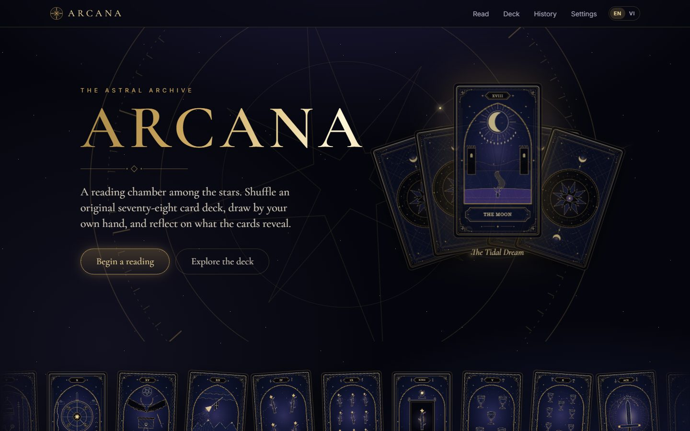
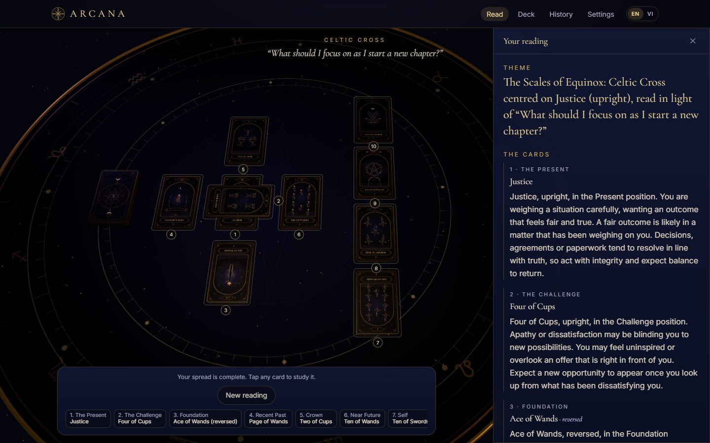
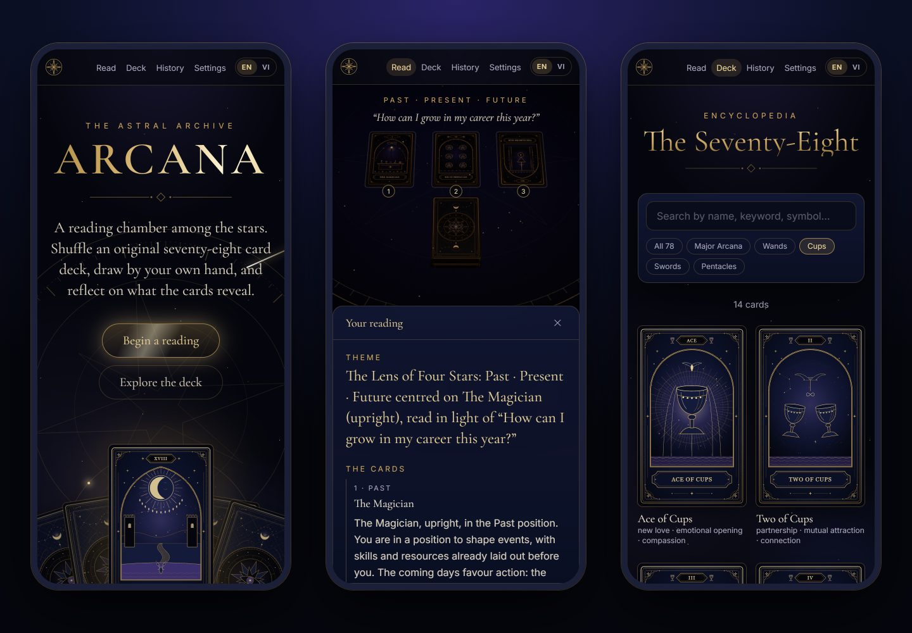
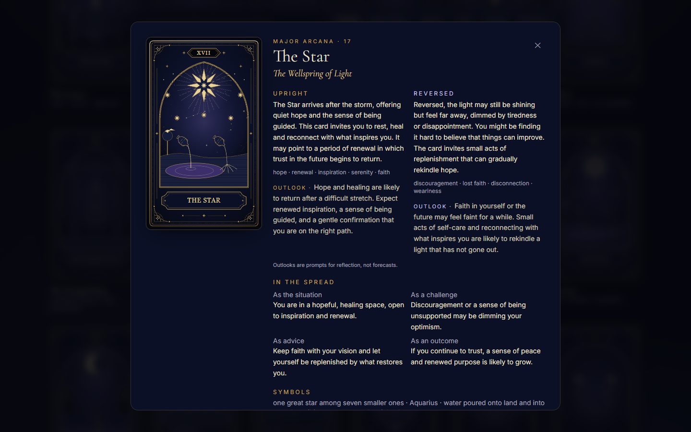

# ARCANA — The Astral Archive

**An immersive 3D tarot reading web app with an original 78-card deck, an AI interpreter, and full English / Vietnamese support.**

Pick a spread, ask a question, then shuffle, draw and turn your own cards on an astral table rendered in WebGL.
When the last card is revealed, ARCANA weaves the actual cards, their positions and orientations into a written reading
you can explore card by card, save, and come back to later.

**[▶ Try the live demo](https://tarrot-ebon.vercel.app)** — no sign-up, nothing to install, works on phones.



> ARCANA is built for reflection, culture and entertainment. It does not predict the future and is not professional
> advice — see the in-app [legal notice](https://tarrot-ebon.vercel.app/legal).

---

## What you can do

| | |
| --- | --- |
| 🔮 **Do a reading** | Four spreads — Daily Guidance (1 card), Past · Present · Future (3), The Crossroads for decisions (5) and the classic Celtic Cross (10). Add an optional question and pick a tone: gentle, direct, poetic or practical. |
| 🃏 **Draw by hand** | Shuffle, then draw each card from the deck and turn it over yourself — by mouse, touch or keyboard — or skip straight to the result. |
| 📜 **Read the interpretation** | A theme for the whole spread, a paragraph per card in its position, how the cards relate, patterns (shared elements, Major Arcana, reversals), reflection questions, small next steps and a closing summary. Tap any card for its full meaning. |
| 📚 **Explore the deck** | An encyclopedia of all 78 cards with search and suit filters: upright and reversed meanings, keywords, symbols and what each card means as a situation, challenge, advice or outcome. |
| 🕰️ **Keep a history** | Every reading is saved on your device and can be reopened (or re-interpreted) later. |
| 🌐 **Switch language** | One tap switches everything — interface, all 78 cards, the card artwork's titles and the readings themselves — between English and Tiếng Việt. |
| ♿ **Make it comfortable** | Reduced motion, a 2D mode, high contrast, larger text, optional sound, full keyboard control and screen-reader announcements. |



## How it works

1. **Compose.** Choose a spread, type a question if you like, and pick a tone.
2. **Shuffle.** The moment you press *Shuffle the deck*, all 78 cards are shuffled with the browser's cryptographic
   random generator and each gets an orientation (upright or reversed). **Your reading is fixed right then** — the
   shuffle, draw and flip animations only reveal it, so they can be skipped without changing anything.
3. **Draw and reveal.** Tap the deck to deal each card into its position, then tap a card to turn it over.
4. **Reflect.** Once every card is face up, the reading is written:
   - **Offline archive (default).** Composed instantly in the browser from each card's own meaning for that position
     and orientation. No API key, no network call — this is what the public demo runs.
   - **AI interpretation (optional).** The server sends the cards to Claude, which writes a reading tailored to your
     question and tone. Turn it on in Settings once an `ANTHROPIC_API_KEY` is configured.
5. **Return to it.** The reading is saved to your browser's history; nothing is stored on a server.

<p align="center">
  
</p>

## Built with

| Area | Technology |
| --- | --- |
| Framework | **Next.js 16** (App Router, Turbopack, Cache Components), **React 19**, **TypeScript** |
| 3D | **Three.js** with **React Three Fiber** and **drei** — custom table, sky shader, particles and card meshes |
| Animation | **Motion** for UI transitions; CSS keyframes for ambient effects |
| Styling | **Tailwind CSS 4** with a small custom design system (gold-on-midnight tokens, engraved type) |
| AI | **Claude** via the official **Anthropic SDK**, with structured outputs validated by **Zod** |
| Testing | **Vitest** and **Testing Library** — 79 unit, integration and component tests |
| Hosting | **Vercel** (static pages plus one serverless API route) |

## Engineering highlights

- **Fair by construction.** The shuffle is a Fisher–Yates over `crypto.getRandomValues`, done once up front. Animations
  can never influence which cards you get, and the card back is symmetric so a reversal can't be spotted early.
- **The server trusts nothing it's sent.** `/api/reading` checks the deal (right count, right positions, no duplicates,
  known card ids), rebuilds every card's meaning from its own data, and validates the model's answer against a Zod
  schema — including that it discusses exactly the cards drawn, in order. Failures come back as typed, retryable
  errors; a reading is never made up. The route is rate-limited and has a request-size cap and a timeout.
- **An original deck, drawn in code.** All 78 card faces and the back are SVG generated procedurally
  (`lib/tarot/art`): a unique illustration for each Major Arcana card, engraved suit emblems for the minors, and a
  star field seeded from each card's id. No third-party artwork is used.
- **3D that degrades gracefully.** The WebGL scene loads on demand, reuses geometry and textures, does no per-frame
  allocation, and runs its sky and dust in shaders. If WebGL is missing, the GPU context is lost or the scene
  throws, the app switches to a 2D spread built from the same layout data.
- **Truly bilingual.** The Vietnamese dictionary is type-checked against the English one, and the deck text, the art,
  the offline reading phrases, the legal notice and the AI prompt all follow the chosen language.
- **Accessible.** Every card is also a real button, draws and reveals are announced to screen readers, all actions
  have keyboard shortcuts, and every animation respects reduced-motion preferences.
- **Private by default.** No accounts, cookies, analytics or ads. History and settings live in `localStorage`, and a
  question leaves the device only if the user turns AI interpretation on.
- **Release-ready.** Per-page metadata, Open Graph share image, `sitemap.xml`, `robots.txt`, a web app manifest with
  install icons, and a version, commit and build-time stamp in the footer of every deploy.



---

## Run it locally

Requires Node.js 20.9 or newer.

```bash
git clone https://github.com/LeQuy-123/tarrot.git
cd tarrot
npm install
npm run dev          # http://localhost:3000
```

The app works immediately in its offline-archive mode. To enable AI readings:

1. `cp .env.example .env.local` and set `ANTHROPIC_API_KEY=...`
2. Restart the server.
3. Turn on **Settings → Reading → AI interpretation** (the page shows whether the server has a key).

If AI interpretation is on but no key is configured, the reading shows a clear "isn't set up" message with a link to
Settings — the cards are still drawn and saved.

| Script | What it does |
| --- | --- |
| `npm run dev` | Development server |
| `npm run build` / `npm start` | Production build / serve it |
| `npm run typecheck` | Generate Next route types, then `tsc --noEmit` |
| `npm run lint` | ESLint (Next core-web-vitals, TypeScript and React Compiler rules) |
| `npm test` | Vitest suites |
| `npm run check` | typecheck + lint + test |

### Configuration

Server-side only — never prefix these with `NEXT_PUBLIC_`. The API key is read only inside the `/api/reading` route
handler and never reaches the browser bundle.

| Variable | Default | Purpose |
| --- | --- | --- |
| `ANTHROPIC_API_KEY` | — | Enables Claude for AI readings |
| `ARCANA_AI_PROVIDER` | auto | Unset: Claude if a key is present, otherwise AI is unavailable. `anthropic` or `mock` force a provider |
| `ARCANA_AI_MODEL` | `claude-opus-5-5` | Override the Claude model |
| `ARCANA_AI_TIMEOUT_MS` | `45000` | Abort provider calls after this long |
| `ARCANA_MOCK_FAIL` | — | Mock only: simulate `timeout`, `rate_limit`, `malformed`, `unavailable` |
| `ARCANA_MOCK_DELAY_MS` | `900` | Mock only: artificial latency |

Public, optional:

| Variable | Purpose |
| --- | --- |
| `NEXT_PUBLIC_SITE_URL` | Origin for canonical links, `sitemap.xml`, `robots.txt` and the share card. Defaults to the Vercel production domain; set it for a custom domain |
| `NEXT_PUBLIC_ARCANA_OPERATOR`, `NEXT_PUBLIC_ARCANA_CONTACT_EMAIL`, `NEXT_PUBLIC_ARCANA_ADDRESS` | Contact details shown on the legal notice |

The Claude provider uses structured outputs (a Zod schema), `effort: "medium"`, and server-side refusal fallbacks
(`fallbacks: "default"`, beta `server-side-fallback-2026-07-01`), so a policy decline on the primary model is retried
on the default fallback model. Remove those two fields in `lib/ai/providers/anthropic.ts` if you prefer declined
requests to stay declined.

### Deploying

Import the repository in Vercel — no settings are needed for the demo. Add `ANTHROPIC_API_KEY` in the project's
environment variables to offer AI readings. The rate limiter is in-memory per instance, which is fine for a demo; use
a shared store (for example Redis) before relying on it to cap API spend under real traffic.

## Project structure

```
app/
  page.tsx                 landing page (animated hero, card ribbon, spreads, how it works)
  reading/                 the reading chamber
  deck/  history/  settings/  legal/
  api/reading/route.ts     POST endpoint: validation, rate limit, error mapping
  api/reading/status/      GET: is an AI provider configured?
  sitemap.ts  robots.ts  manifest.ts  opengraph-image.tsx  icon.svg
components/
  scene/                   R3F canvas, environment (table, rings, sky, dust), camera rig, textures
  cards/                   3D card and deck (shuffle animation), SVG→texture, 2D card images
  spreads/                 spread layout maths, 2D spread renderer, spread diagrams
  reading/                 reading flow orchestrator, setup, HUD, card detail, interpretation, history
  deck/                    encyclopedia with search and filters
  ui/                      header, footer, hero, landing sections, settings, sigils
lib/
  tarot/deck/              78 card records (data only) + Vietnamese translations + search
  tarot/art/               procedural SVG artwork: frame, 22 Major illustrations, minor emblems, back
  tarot/spreads.ts         the four spreads: positions, labels, lenses, layout coordinates
  tarot/selection.ts       pure shuffle / deal / validate functions
  tarot/random.ts          crypto RNG + seeded PRNG for tests
  reading/machine.ts       pure reducer for the reading flow
  reading/interpretation.ts  offline archive reading vs. AI endpoint, chosen by the setting
  ai/                      schemas, prompt context, engine, providers (anthropic, mock), client fetcher
  i18n/                    English / Vietnamese messages and language store
  storage/                 validated localStorage stores (history, settings)
  site.ts                  site URL and shared SEO metadata
types/tarot.ts             shared domain types
tests/                     Vitest suites
```

### Spreads

| Spread | Cards | Positions |
| --- | --- | --- |
| Daily Guidance | 1 | Today's Lens |
| Past · Present · Future | 3 | Past, Present, Future |
| The Crossroads (decision) | 5 | Heart of the Matter, Path A, Path B, Unseen Factor, Counsel |
| Celtic Cross | 10 | Present, Challenge (crossing), Foundation, Recent Past, Crown, Near Future, Self, Environment, Hopes & Fears, Outcome |

Each position carries an interpretation *lens* (`self`, `obstacle`, `guidance`, `outcome`), and every card has a
sentence for each lens, so position-specific meaning comes from data rather than templates.

### 3D details

- The canvas is loaded with `next/dynamic` (`ssr: false`) from a client component.
- Cards are a bevelled rounded-rectangle extrusion with a gold edge and separate front and back faces; the back face's
  UVs are mirrored to compensate for its 180° rotation, so neither side is ever mirrored.
- Flips rotate around the card's long axis; a reversal is a 180° turn around the table normal, so reversed artwork
  is upside-down, never mirrored.
- Card art is rasterised once per card to a 510×850 canvas texture and shared.
- Reduced motion makes animations instant and stills the sky and dust.

### Keyboard

Space / Enter / D draw · R reveals the next card · A draws and reveals everything · ← / → move between revealed
cards · S / Esc skip animations or close a card.

## Notes for maintainers

### Artwork limitations

The art is emblematic (no human figures), pip cards 3–10 share one arrangement per number across suits, and a few
small details (the Chariot's sphinxes, Judgement's trumpet) are crude at thumbnail size.

### Legal positioning

ARCANA is presented as a tool for **self-reflection, culture and entertainment**, not fortune-telling. A bilingual
disclaimer appears in the footer of every page except the full-screen chamber, which links to the notice from its
setup screen and reading panel. The full notice (`/legal`) covers: no predictions or guarantees, not professional
advice, no paid readings / rituals / "giải hạn" plus a scam warning, lawful use, AI-generated content, data and
privacy, age, and artwork.

Keep it that way when extending the product: avoid paid predictions, ritual or bad-luck-removal services, and
promises about the future. The AI system prompt (`lib/ai/context.ts`) also forbids recommending rituals or paid
services, asking for money or personal data, and claiming certainty. The notice is not legal advice — get proper
legal review before charging users or targeting a specific market.

### Languages

The header's **EN / VI** toggle (also in Settings) is saved in the browser; visitors whose browser language is
Vietnamese get Vietnamese by default. Pages render in English on the server and switch after load, so there is no
hydration mismatch, but Vietnamese visitors may briefly see English on first paint.

### Privacy facts the legal notice relies on

Keep these true, or update `components/legal/LegalNotice.tsx` (and its "Last updated" date) when they change:

- No accounts, no cookies, no advertising, no analytics, and no runtime requests to third-party hosts.
- Reading history, settings and language live only in `localStorage` (`arcana.history.v1`, `arcana.settings.v1`,
  `arcana.lang.v1`); Settings → "Clear all data on this device" removes all three.
- The server keeps client IPs in memory for about one minute for rate limiting and logs error codes, not questions.
- Questions are sent to the AI provider only when AI interpretation is on.
- Set the `NEXT_PUBLIC_ARCANA_*` contact variables before a public launch; until then the Contact section says no
  contact details have been published.
